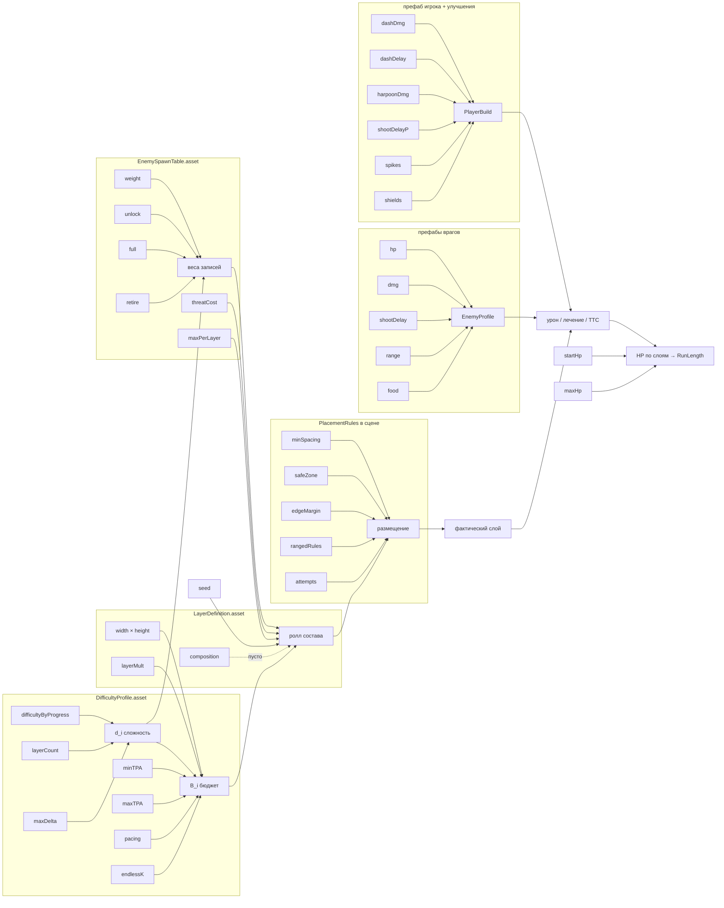

# 05. Граф зависимостей параметров

## Поток «число → результат»

## Таблица трассировки

| Параметр | Где лежит | На что влияет напрямую | Косвенно |
|---|---|---|---|
| `difficultyByProgress`, `layerCount`, `maxDifficultyDeltaPerLayer` | DifficultyProfile | `d_i` | веса врагов, бюджет, момент появления LevelUp/ухода Bee |
| `minThreatPerArea`, `maxThreatPerArea` | DifficultyProfile | `B_i` | число врагов, PlacementLoss |
| `pacing[]` | DifficultyProfile | `B_i` на выбранных слоях | ритм «передышка/пик» |
| `endlessThreatGrowth` | DifficultyProfile | `B_i` при i ≥ 30 | бесконечный рост |
| `widthRange`, `heightRange` | LayerDefinition | площадь → `B_i`; вместимость размещения | PlacementLoss, длина слоя по времени |
| `threatMultiplier` (слоя) | LayerDefinition | `B_i` | — |
| `composition` | LayerDefinition | квоты ролей | — (пусто) |
| `threatCost` | SpawnTable | сколько экземпляров влезает в бюджет | плотность, доля еды/угроз |
| `weight`, `unlock`, `full`, `retire` | SpawnTable | вероятность записи при `d` | состав по слоям |
| `maxPerLayer` | SpawnTable | кап | куда уходит остаток бюджета |
| `minSpacing`, `edgeMargin`, `safeZoneHeight` | сцена (EnemyScatterGenerator) | вместимость | PlacementLoss → реальная плотность |
| `rangedMinRange`, `rangedEntryClearance`, `maxCoveringRanged` | сцена | где стоят Pear | урон у входа |
| `attemptsPerEnemy` | сцена | вероятность разместить | PlacementLoss |
| `startHp` (Stats врага) | префаб | KillableHp, EatableByDash | TTC, лечение |
| `isImmortal`, `isInvulnerable` | префаб | архетип (ловушка/награда) | роль в таблице |
| `TriggerDamage.dmg` | префаб | ExpectedDamage (контакт) | — |
| `EnemyShooter.shootDelay/detectionRange`, снаряд | префаб + ProjectileDefinition | ExpectedDamage (дальний); `range` для размещения | — |
| `Yummy.hpCure` | префаб | ExpectedHeal | — |
| `dashDmg`, `dashDelay`, `powerDash`, `dashTime` | префаб игрока / JawUp / DashUp | DashDps, EatableByDash | TTC, лечение |
| `shootDelay` (игрок), `ArrowProjectile.damage` | префаб игрока / ArrowUp | HarpoonDps | TTC |
| `ownerForce`, `targetForce` | ArrowProjectile | мобильность (вне модели) | скорость прохождения слоя |
| `maxLevel`, `isPassive` | ImprovementDefinition | доступные варианты на LevelUp | состав сборки |
| `defaultSaveData.hp` | Boot.unity | `hp_0` | RunLength |
| `maxHp` | префаб игрока | потолок лечения | RunLength |
| `DeadZone.dmgDelay` | префаб DeadZone | урон вне границ (вне модели) | — |

## Что дублируется (риск рассинхронизации)

| Дубль | Где | Правило |
|---|---|---|
| Стартовое HP игрока | `Stats.startHp` (4) и `SaveSystem.defaultSaveData.hp` (4) | авторитет — `SaveSystem`; `Stats.startHp` у игрока не используется |
| Планирование слоя | `GeneratorsManager` и симулятор | обязаны звать `LayerPlanner.Plan` (проверяется тестом детерминизма) |
| `PlacementRules` | сцена и `BalanceScenario.placement` | при правке в сцене обновить сценарий (оба сейчас = значения по умолчанию) |
| Сложность | `currentDifficulty` (сцены) и `d_i` (слои) | не связаны — см. `06`, A3 |
